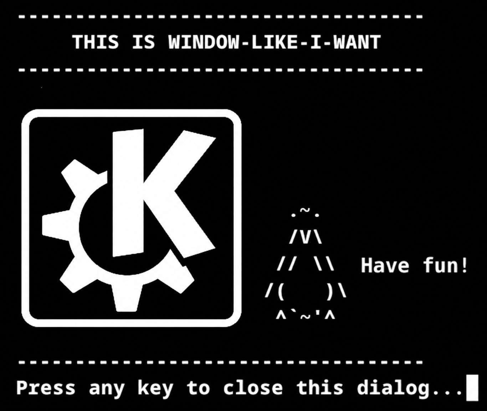

# window-like-i-want



Start an application and have **KWin** put its window exactly where you want
it: size, position, screen, window mode and stacking — described in a small
configuration file, applied the moment the window appears.

KDE Plasma can remember window rules, but it cannot express *"launch this
command, and place **that** window at the top right of my third monitor at
563x440"*. This project can, by generating a throwaway KWin script per run.

```bash
./window-like-i-want.bash -c myapp
```

---

- [Installation](#installation)
- [Using it](#using-it)
- [Writing a configuration](#writing-a-configuration)
- [How it works](#how-it-works)
- [Repository layout](#repository-layout)
- [Developing](#developing)
- [Testing](#testing)
- [Troubleshooting](#troubleshooting)
- [Known limitations](#known-limitations)
- [About](#about)

---

## Installation

### 1. Prerequisites

| Requirement | Why |
|---|---|
| KDE Plasma with **KWin** (tested on Plasma 6) | the window manager being scripted |
| `qdbus` | loads and unloads the generated KWin script |
| **BASH 4.3+** | the code relies on namerefs (`local -n`) |
| `awk` | the decimal latency arithmetic |
| `konsole` | only if a configuration launches it, as the example does |
| Node.js 20+ and `yarn` or `npm` | **only to rebuild** the KWin script, never to run it |

On Plasma 6 the D-Bus tool is usually **`qdbus6`** (Arch based systems:
`qt6-tools`). [bash-script/utils/qdbus.bash](bash-script/utils/qdbus.bash)
finds it under any of its names.

**Nothing has to be installed for the TypeScript side.** What the project
loads is the compiled bundle,
[kwin-script/dist/window.js](kwin-script/dist/window.js), and it is committed.
A fresh clone has no `node_modules` and does not need one: Node.js, `npm` and
the dependencies are only for rebuilding that bundle after changing
`kwin-script/src/`.

### 2. Create your configuration

From inside the cloned folder:

```sh
cp configs/_config_model.bash configs/myapp.bash
```

Open it and say what to start and where to put it. Every parameter is
documented inline, and in full in
[docs/configuration.md](docs/configuration.md). Check it without anything
appearing on screen:

```sh
./window-like-i-want.bash -c myapp --dry-run
```

It writes the KWin script it would load, says where, and stops there.

**NOTE:** `configs/` is ignored by git apart from the model, so the commands
and screen indexes of your machine never end up in a commit. Names starting
with `_` are models: not listed, not runnable.

### 3. Turn it into a command

Clone it and link it into a folder that is in your `PATH`:

```sh
git clone https://github.com/eduardolucioac/window-like-i-want.git
cd window-like-i-want
chmod a+x window-like-i-want.bash
mkdir -p ~/.local/bin
ln -s "$(pwd)/window-like-i-want.bash" ~/.local/bin/window-like-i-want
```

Then, from any folder:

```sh
window-like-i-want -c myapp
```

**NOTE:** `~/.local/bin` is the usual place for a user's own commands, but not
every distribution puts it in the `PATH` by default. Check with
`echo "$PATH" | tr ':' '\n' | grep local/bin` and, if nothing comes out, add
this to your `~/.bashrc`:

```sh
case ":$PATH:" in *":$HOME/.local/bin:"*) ;; *) PATH="$HOME/.local/bin:$PATH" ;; esac
```

**TIP:** Link it, do not copy it. The script resolves the link before looking
for its own files, so it always finds them beside the **real** script.

### 4. Bind it to a shortcut

The point of all this is usually a key combination. In *System Settings ->
Shortcuts -> Custom Shortcuts*, add a command action running
`window-like-i-want -c myapp`.

## Using it

```bash
./window-like-i-want.bash --help        # usage, and the configurations available
./window-like-i-want.bash -c myapp      # run one
```

| Option | Meaning |
|---|---|
| `-c`, `--config-to-use` | name of a file in [configs/](configs/), without `.bash` (required) |
| `-h`, `--help` | usage, plus the list of available configurations |
| `--dry-run` | generate the KWin script and say where, without starting anything |

It may be started from any directory: every path is resolved against the
script's own location.


## Writing a configuration

A configuration is a plain BASH file in [configs/](configs/) setting a handful
of variables, copied from
[configs/_config_model.bash](configs/_config_model.bash). Every parameter is
documented inline, and worked examples are in
**[docs/configuration.md](docs/configuration.md)**.

Positions are short codes:

```
  tld ──── tc ──── trd        dtl ── dt ── dtr
   │        │        │         │            │
   cl ───── c ───── cr         dl          dr
   │        │        │         │            │
  bld ──── bc ──── brd        dbl ── db ── dbr

  regular (9)                 docking (8)
```

`WINDOW_X_POSITION`/`WINDOW_Y_POSITION` override `WINDOW_POSITION` with
absolute pixel coordinates.

## How it works

Two halves that meet through a generated file.

```
  window-like-i-want.bash
      │
      ├─ options.bash ............ parses -c / -h / --dry-run
      ├─ configs/<name>.bash  sets WINDOW_*, APPLICATION_STARTUP_COMMAND, ...
      │
      └─ controller.bash
             │  1. start the application, keep its PID
             ├──── c_window.f_start_application
             │
             │  2. read kwin-script/dist/window.js into a HEREDOC so BASH
             │     expands $konsole_pid, $window_width, $screen_index, ...
             ├──── c_window.f_prepare_configuration
             │
             │  3. write /tmp/<uuid>.js and hand it to KWin over D-Bus
             ├──── c_window.f_set_configuration ──── qdbus org.kde.KWin
             │                                            │
             │                                            ▼
             │                                     window.js runs inside KWin:
             │                                      . workspace.windowAdded
             │                                      . match window by PID
             │                                      . opacity = 0  (hide)
             │                                      . set frameGeometry
             │                                      . dock / maximize / fullscreen
             │                                      . restore opacity
             │
             │  4. after KWIN_SCRIPT_CONFIGURATION_LATENCY, unload and delete
             └──── c_window.f_unset_configuration
```

Two details worth knowing:

- **Values reach the KWin script through BASH expansion, not arguments.** KWin
  scripts take no parameters, so the compiled bundle carries `$placeholders`
  (see [src/main.ts](kwin-script/src/main.ts)) and is run through a HEREDOC
  that substitutes them. That is why the bundle is read as text, not imported.
- **The window is hidden while it is moved.** Setting geometry on a window
  already on screen produces a visible jump, so the script drops the opacity to
  0, applies everything, and fades it back in via
  [TimerChain](kwin-script/src/utils/timer-chain.ts).

Every generated script is named after a per-run UUID, unloaded when the run
ends, and swept up by the trap in
[bash-script/trap/trap.bash](bash-script/trap/trap.bash) if the run is
interrupted.

The application is started with `XDG_STATE_HOME` pointing at a directory of its
configuration, so the window size it records on closing — the one KWin was just
told to impose — does not become the size of the next window you open by hand.
See `ISOLATE_APPLICATION_STATE` in
[docs/configuration.md](docs/configuration.md).

## Repository layout

```
window-like-i-want.bash         entry point: sources everything, in order
configs/
  _config_model.bash            copy this to start a configuration
                                yours go beside it, untracked
bash-script/
  controller.bash               the run sequence
  options/options.bash          command line parsing
  window/window.bash            the "window" object: start, prepare, load, unload
  dialog/                       dialogs, drawn in a Konsole window
    dialog.bash                 spawns and places one
    dialog-box.bash             draws the block of text, at a fixed width
    color-scheme.bash           colour scheme and title per severity, and the
                                private Konsole directory each dialog runs in
    color-schemes/              the four schemes (info/success/warning/error)
    kwin-script/dialog.js       small KWin script that centres the dialog
  error-handling/               turns a failed step into a dialog
  trap/trap.bash                cleanup on exit or interruption
  utils/
    utils.bash                  the support notice
    qdbus.bash                  finds the qdbus binary (qdbus6, qdbus, ...)
    prog-concepts.bash          f_class_constructor: named, validated arguments
kwin-script/                    the KWin side, in TypeScript
  src/main.ts                   entry point, hooks workspace.windowAdded
  src/settings/                 parses and validates the substituted values
  src/window/                   position, docking and mode
  src/utils/timer-chain.ts      sequential QTimer chaining
  src/constant/constant.ts      the valid position and mode codes
  types/kwin.d.ts               the KWin globals, declared not imported
  dist/window.js                committed build output
tests/
  test-bash-side.bash           headless tests, no KWin needed
  test-kwin-side.bash           real geometry tests against a live KWin
  preview-dialogs.bash          open the four dialogs to look at them
  README.md                     how the testing works
docs/configuration.md           every configuration variable
images/                         the banner and the flag used by this file
CHANGELOG.md
```

## Developing

### Rebuilding the KWin script

Only needed after changing anything under `kwin-script/src/`:

```bash
cd kwin-script && npm install && npm run build   # or yarn
```

The output, `kwin-script/dist/window.js`, is committed, and the build is
reproducible: the current `src/` yields the committed bundle byte for byte.

`src/` is not ordinary TypeScript at runtime: the `$placeholder` strings are
substituted by BASH, and the KWin globals (`workspace`, `QTimer`, `print`) are
declared in [types/kwin.d.ts](kwin-script/types/kwin.d.ts) rather than
imported.

### Debugging a run

- `KILL_WINDOW_FOR_DEBUG=1` closes the window a second after placing it, which
  makes trying positions out quick.
- KWin `print()` output goes to the journal, prefixed
  `[WINDOW_LIKE_I_WANT <config> <uuid>]`:
  ```bash
  journalctl --user -f -t kwin_wayland    # or kwin_x11
  ```
- `qdbus6 org.kde.KWin /Scripting` lists the scripts KWin has loaded.

## Testing

```bash
./tests/test-bash-side.bash                  # anywhere, no KWin needed   (~15 s)
./tests/test-kwin-side.bash                  # needs a live KWin session  (~45 s)
./tests/preview-dialogs.bash --all-at-once   # look at the dialogs
```

The first covers everything before KWin is involved, using `--dry-run`. The
second places a real window, reads back the geometry KWin actually gave it, and
compares that with the rectangle recomputed independently — by loading a probe
KWin script whose `print()` lands in the journal.

Details in **[tests/README.md](tests/README.md)**.

## Troubleshooting

**"No `qdbus` binary found."** Install `qt6-tools` (Arch based systems).

**"KWin refused to load the script."** You are not in a KWin session, or
`qdbus` cannot reach it. Check with `qdbus6 org.kde.KWin`.

**"The application did not report a PID."** `APPLICATION_STARTUP_COMMAND` must
end with `&`: the window is matched by PID.

**"KWin script bundle not found."** Build it, see
[Developing](#rebuilding-the-kwin-script).

**The window appears but is not moved.** It took longer to map than
`KWIN_SCRIPT_CONFIGURATION_LATENCY` allowed, so the script was already
unloaded. Raise it, for example to `2.0`.

**The window is not moved or resized at all.** Some applications refuse; see
[Known limitations](#known-limitations).

**The window is on the wrong screen.** `SCREEN_INDEX` follows KWin's screen
order, which need not match System Settings. Try the other indexes.

## Known limitations

- **One window per run, matched by PID.** An application that hands the request
  to an already running instance (most browsers) spawns no new PID and cannot
  be targeted; a command opening several windows has all of them matched.
- **Not every application can be placed.** On Wayland the client has the final
  say over the size of its own surface. `konsole` accepts what it is told;
  `alacritty` ignores both position and size. This is not a PID matching
  failure — the script does find the window.
- **Docking ignores `WINDOW_WIDTH`/`WINDOW_HEIGHT`:** KWin picks the size when
  it tiles. Docking and `WINDOW_MODE` go through KWin "slots", which act on the
  active window, so the script activates the target first.

---

## About

This is free software and will stay that way. If it saved you some time, come
and say hello.

Set `I_SUPPORT_FREE_SOFTWARE_N_THIS_WORK=1` in your configuration to silence
the notice printed on every run.

window-like-i-want 🄯 BSD-3-Clause — see [LICENSE](LICENSE)  
Eduardo Lúcio Amorim Costa  
Brazil-ES  
https://www.linkedin.com/in/eduardo-software-livre/


